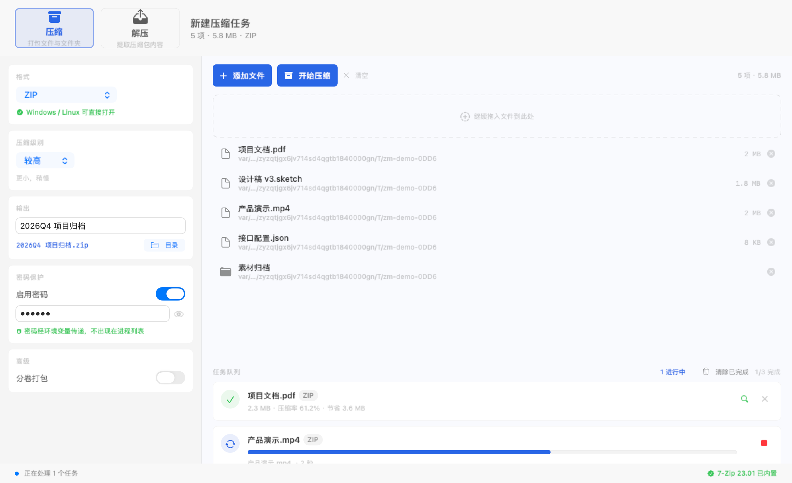
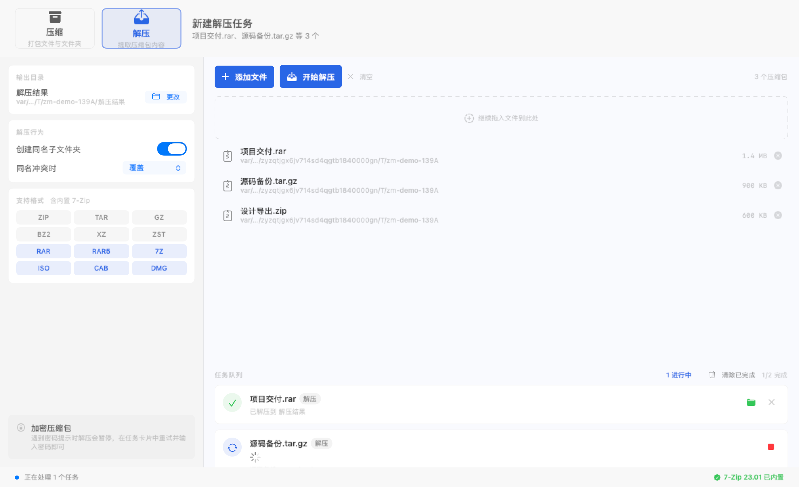

# ZipMate · macOS 压缩大师

原生 macOS 压缩 / 解压工具，SwiftUI 界面 + 系统原生工具引擎 + **内置 7-Zip**，无需额外安装。

  

---

## 快速开始

```bash
cd ZipMate
./build.sh          # 构建 ZipMate.app
open dist/ZipMate.app
```

重新构建：`./build.sh`　运行测试：`./test_e2e.sh`　渲染 UI 快照：`./Tools/snapshot.sh`




---

## 功能

### 压缩

| 格式 | 说明 | 密码 | 分卷 | 跨平台 |
|------|------|:----:|:----:|:------:|
| ZIP | Info-ZIP 3.0 | ✅ | ✅ | ✅ |
| 7Z | 内置 7-Zip 23.01 | ✅ | ✅ | ❌ |
| TAR + GZIP | 标准选择 | — | — | ✅ |
| TAR + XZ | 压缩率最高 | — | — | ✅ |
| TAR + BZIP2 | 兼容老系统 | — | — | ✅ |
| TAR + Zstandard | 速度最快 | — | — | ✅ |
| TAR | 不压缩 | — | — | ✅ |

- 6 档压缩级别（仅存储 → 极限）
- 密码保护（ZIP / 7Z）
- 分卷打包（ZIP 按 MB 分卷）
- 自动排除 `.DS_Store` 与 `__MACOSX`
- 完成后显示压缩率与节省体积

### 解压

- **自动识别格式**：读文件头魔数，不依赖扩展名（改错后缀照样能解）
- **内置 7-Zip 23.01**，开箱即支持 RAR / RAR5 / ISO / CAB / DMG 等
- 支持 ZIP / TAR / GZ / BZ2 / XZ / ZST / 7Z / RAR
- 覆盖策略：覆盖 / 跳过 / 自动重命名
- 可选创建同名子文件夹
- 完成��一键在 Finder 中定位

### 安全

- **路径穿越防护**：解压前扫描全部条目，拒绝 `../`、绝对路径、`~` 开头的条目（zip-slip 攻击）
- **密码不落进程列表**：密码经环境变量注入，`ps` / 活动监视器不可见（常规 `-P` 方案会明文暴露 argv）
- **取消分级**：SIGTERM → 2 秒宽限 → SIGKILL，不留僵尸进程
- **shell 注入防护**：所有参数经 POSIX 单引号转义

### 界面设计原则

- **设计令牌集中管理**：`Space`（8pt 栅格）/ `Radius`（连续圆角）/ `Ink`（语义色）
  全部命名，不在视图里散落魔法数字
- **层次靠材质而非描边**：卡片用 `.regularMaterial` + 顶部白色渐变高光 + 双层细描边
  （一层白一层黑）营造厚度，避免"贴纸感"
- **主次分明**：强调色仅用于模式标识、主按钮、进度条；其余走中性灰阶
- **模式切换整体换色**：压缩蓝 / 解压绿，`Accent` 结构体统一分发
- **格式支持可视化**：常规格式灰色徽章，靠内置 7-Zip 的（RAR/ISO/CAB…）绿色高亮，
  一眼看出能力边界
- **路径折叠**：`~` 缩写 + 中间层级折叠为 `…`，避免长路径撑爆布局

### 视觉验证方式

`./Tools/snapshot.sh` 用 `NSHostingView.cacheDisplay` 离屏渲染 PNG
（1180×720 @2x），**不需要屏幕录制权限**，可进 CI。
每次改 UI 后跑一次即可自查，比肉眼在真窗口里找问题快得多。

---

## 快捷键

| 操作 | 快捷键 |
|------|--------|
| 压缩 Finder 选中项 | `⇧⌘C` |
| 解压剪贴板中的压缩包 | `⇧⌘V` |
| 取消全部任务 | `⌘.` |
| 打开主窗口 | `⌘O` |

---

## 菜单栏

应用常驻菜单栏（点击图标展开）：

- 打开主窗口
- 压缩 Finder 选中项
- 快速压缩（ZIP / 7Z / TAR.GZ … 直接出包，不进主界面）
- 退出

---

## 架构

```
Sources/
├── Core/
│   ├── Formats.swift        格式定义 + 工具探测
│   ├── Probe.swift          魔数识别（不靠扩展名）
│   ├── ProcessRunner.swift  流式进程执行 + 分级取消
│   ├── ShellQuote.swift     POSIX 引号转义 + 密码环境变量注入
│   ├── ArchiveEngine.swift  压缩/解压核心
│   ├── JobQueue.swift       任务队列（串行调度 + 进度）
│   └── SelfTest.swift       引擎自测
├── UI/
│   ├── DesignSystem.swift   设计令牌（间距/圆角/色板/卡片/进度条）
│   ├── ContentView.swift    主界面
│   ├── AppModel.swift       界面状态
│   ├── Router.swift         菜单栏 → 窗口消息路由
│   └── Snapshotter.swift    离屏渲染（视觉验证）
└── App/ZipMateApp.swift     入口 + 菜单栏 + Finder 集成

Tools/
├── make_icon.py             程序化生成 .icns
├── make_services.sh         生成 Finder 服务菜单
├── fetch_7zip.sh            下载并内置 7-Zip（官方源）
├── snapshot.sh              离屏渲染 UI 快照（免截屏权限）
└── snapshot/main.swift      快照演示数据

vendor/7zz                   内置的 7-Zip 23.01（universal）
Tests/fixtures/              真实 RAR5 测试样本
```

### 关键设计

**0. 为什么必须内置 7-Zip**
已实测：macOS 自带的 `tar` / `unzip` / `ditto` **全部无法解压 RAR**
（`End-of-central-directory signature not found` / `Couldn't read PKZip signature`）。
7-Zip 官方 macOS 版是唯一免安装的可靠方案。

**1. 绝对路径调用系统工具**
本机 PATH 中的 `zip` / `tar` 可能被第三方 shim 劫持，因此全部使用 `/usr/bin/...` 绝对路径。

**2. 密码经环境变量注入**
`zip -P <密码>` 会把明文写进 argv，任何本机进程 `ps` 都能看到。ZipMate 改用：

```
sh -c 'exec /usr/bin/zip -P "$ZIPMATE_SECRET" ...'   # argv 只有占位符
环境变量：ZIPMATE_SECRET=<真实密码>                  # 仅本用户可读
```

**3. 魔数识别代替扩展名**
`ArchiveProbe` 读取文件头判断真实类型，支持 `PK`、`7z¼¯'\\¢'`、`Rar!`、`\x1f\x8b`、`BZh`、`\xfd7zXZ`、`zstd`、`ustar`。

**4. 进度来自真实输出**
不伪造进度条 —— 解析 zip 的 `adding:` 行数、bsdtar 的 `-v` 条目行、7z 的百分比回显，按已处理条目 / 总条目计算。

---

## RAR 压缩说明

7-Zip 官方版**只含 RAR 解码器，不含编码器**（unrar 许可限制），因此 ZipMate
的 RAR 是**仅解压**。如需产出 `.rar`，请用系统 tar/zip 或 WinRAR。

---

## 环境

- macOS 14+（arm64 / x86_64）
- Xcode Command Line Tools 或完整 Xcode
- 7-Zip 可选：`brew install sevenzip` 或安装 Keka（用于 7z / RAR）

> 构建脚本会自动优先使用 `/Applications/Xcode.app`（SwiftUI 宏插件完整），
> 回退到 CommandLineTools。

**7-Zip 已内置**：`Tools/fetch_7zip.sh` 从 7-zip.org 下载官方 macOS 版（universal，
arm64 + x86_64）到 `Contents/Helpers/7zz`，随 app 分发。无需用户自行安装。

---

## 测试

```bash
./test_e2e.sh
```

覆盖 17 项：
- 6 种格式压缩→解压→SHA256 字节级比对
- **真实 RAR5 包解压 + 内容/行数比对**（样本来自官方 rarlab）
- 7Z 格式往返 + 加密往返（正确密码可解 / 错误密码被拒）
- 密码不出现在进程列表
- 对照实验：系统工具确实解不了 RAR
- 路径穿越拦截、取消机制、引擎自测 14 项
